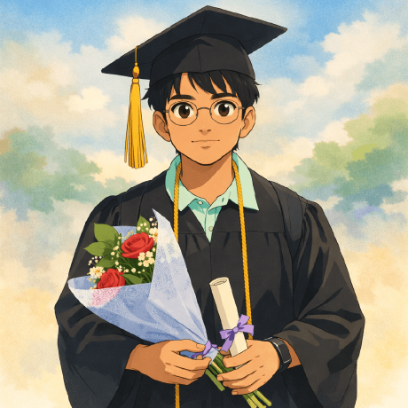

<!-- ===================== 🌸 TAKEOFF ✈️ ===================== -->
<p align="center">
  
</p>

<p align="center">
  
</p>

<p align="center">
  <a href="https://github.com/DeveloperMindset123">
    
  </a>
</p>

<p align="center">
  
  
  
</p>

<p align="center">🌸 ─────────── ✈️ ─────────── 🌸</p>

## 🛫 Pre-Flight Briefing

```python
about_me = {
    "AyanDas": {
        "languages": ["C++", "Python", "Rust", "TypeScript"],
        "robotics": ["ROS2", "Jetson Orin", "Linux", "Sensor Integration"],
        "computerVision": ["OpenCV", "Object Detection", "Image Processing"],
        "agenticDevelopment": ["Cursor", "GitHub Copilot", "Claude Code", "ChatGPT", "Microsoft Copilot"],
        "currentlyBuilding": [
            "Autonomous Robotics",
            "Robot Perception",
            "Edge AI Systems",
            "GPU-Accelerated Applications",
        ],
    }
}
```

```rust
const CURRENT_INTERESTS: &str = r#"
- Reinforcement learning and robotics
- External research with IBM: Predictive Maintenance & Prognostic Health Management for industrial assets
- Online M.S. at Georgia Tech focused on Perception and Robotics
"#;

const INTERESTS: [&str; 4] = [
    "Perception & Tracking",   // current academic focus
    "Reinforcement Learning",  // foundations of neural networks
    "Robotics",                // end-to-end HW/SW for land, air & water autonomy
    "Technical Architect",     // long-term IC leadership goal
];

const YEARS_OF_EXPERIENCE: f32 = 2.5; // Always Building...
```

<p align="center">🌸 ─────────── ✈️ ─────────── 🌸</p>

## 🧰 Cockpit Instruments

<p align="center">
  <a href="https://skillicons.dev">
    
  </a>
  <br/>
  <a href="https://skillicons.dev">
    
  </a>
</p>

<p align="center">
  
  
  
</p>

<p align="center">🌸 ─────────── ✈️ ─────────── 🌸</p>

## 🧭 Flight Plan

```yaml
flight_plan:
  destination: Autonomous Driving / Robotics Software Engineer
  cruising:    [ROS2, NVIDIA Jetson, CUDA, Computer Vision, Robot Navigation]
  climbing:    [Reinforcement Learning, Sensor Fusion, SLAM]
  research:    [Predictive Maintenance, Prognostic Health Management]
  final_approach: Technical Architect
```

<p align="center">🌸 ─────────── ✈️ ─────────── 🌸</p>

## 📡 Flight Telemetry

<p align="center">
  
  
</p>

<p align="center">
  
</p>

<p align="center">
  
</p>

<p align="center">🌸 ─────────── ✈️ ─────────── 🌸</p>

## 🌸 Contribution Trail

<p align="center">
  <picture>
    <source media="(prefers-color-scheme: dark)" srcset="https://raw.githubusercontent.com/DeveloperMindset123/DeveloperMindset123/output/github-contribution-grid-snake-dark.svg" />
    
  </picture>
</p>

<p align="center">🌸 ─────────── ✈️ ─────────── 🌸</p>

<h3 align="center"><i>"What I cannot create, I do not understand."</i></h3>
<p align="center">— Richard P. Feynman</p>

<p align="center">
  
</p>
